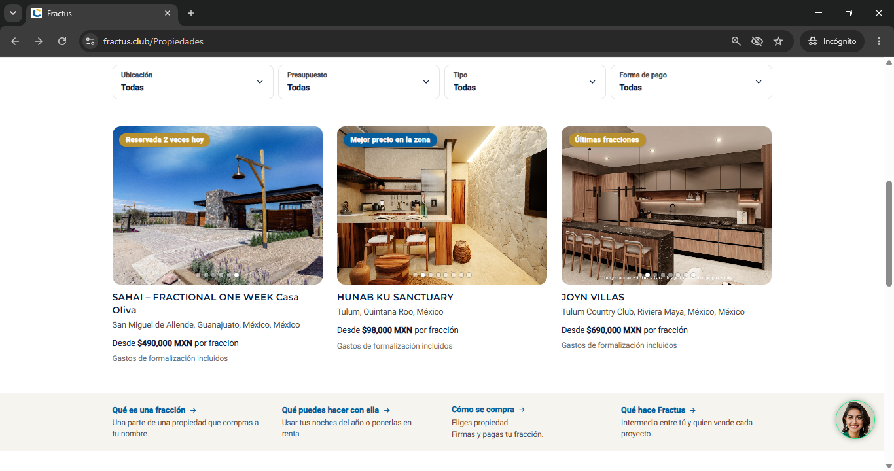
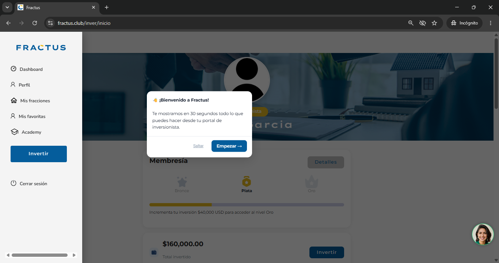
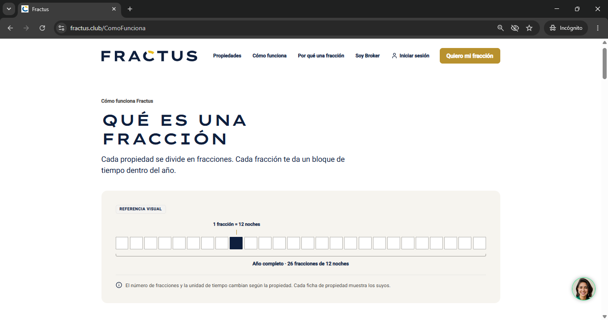
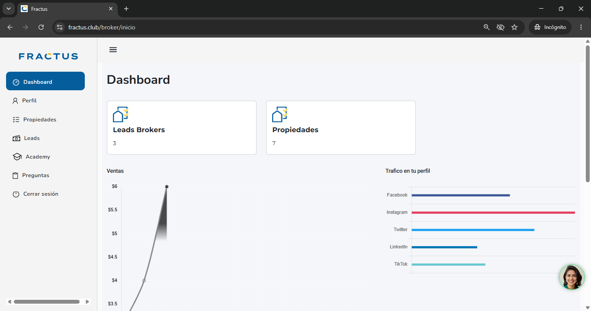

# 🏢 Fractus — Fractional Real Estate Investment Platform

**Role:** Technical Co-founder & Lead Engineer (backend, frontend, infrastructure)
**Live product:** [fractus.club](https://fractus.club)
**Status:** In production, actively developed

> 🇲🇽 **En español:** Fractus es una plataforma de inversión inmobiliaria fraccionada en producción. La diseñé y construí de punta a punta como cofundador técnico: arquitectura de microservicios en Spring Boot sobre AWS, tres aplicaciones Angular (CRM administrativo, portal de brokers y portal de inversionistas) e infraestructura en la nube.

> ℹ️ The source code is private. This page describes the architecture and my work on the platform.

---

## 📸 Screenshots

| Public site                | Investor dashboard                |
|----------------------------|-----------------------------------|
|  |  |

| Public site           | Broker portal                |
|-----------------------|------------------------------|
|  |  |

---

## 🎯 The product

Fractus lets people invest in real estate by buying **fractions of a property** instead of the whole thing. Investors browse properties, buy fractions, upload their payment documents and track their portfolio. Brokers manage listings and clients, and the admin team runs operations from a CRM.

I built the platform end to end alongside a non-technical CEO: from the database and backend services to the three web applications and the cloud infrastructure.

---

## 🏗️ Architecture

```
            ┌──────────────── CloudFront (CDN + SSL) ────────────────┐
            │                                                        │
   ┌────────▼────────┐   ┌──────────────────┐   ┌──────────────────┐
   │  Investor site   │   │   Broker portal   │   │   Admin / CRM    │
   │   (Angular)      │   │    (Angular)      │   │    (Angular)     │
   └────────┬────────┘   └────────┬─────────┘   └────────┬─────────┘
            └──────────────────────┼──────────────────────┘
                                   │ REST + JWT
                     ┌─────────────▼─────────────┐
                     │  Spring Boot microservices │
                     │   (130+ services, AWS)     │
                     └──────┬──────────────┬──────┘
                            │              │
                     ┌──────▼─────┐  ┌─────▼──────┐
                     │   MySQL     │  │  Amazon S3  │
                     │             │  │ (documents, │
                     │             │  │   images)   │
                     └────────────┘  └────────────┘
```

- **Backend:** 130+ Spring Boot microservices, REST APIs, JWT authentication
- **Frontend:** three Angular applications — public/investor site, broker portal, admin CRM
- **Data:** MySQL
- **Storage:** Amazon S3 for property images and investor documents
- **Delivery:** CloudFront CDN with managed SSL

---

## 🛠️ What I built

**Backend**
- Designed and built the microservice architecture and REST APIs
- Transactional property create/update flows, with automatic rollback of S3 uploads if the database operation fails
- JWT-based authentication and role-based access for investors, brokers and admins
- Account recovery (forgot-password) flow
- Investment and portfolio calculations based only on approved payments

**Frontend**
- Investor portal: portfolio dashboard with charts, "My Fractions", favorites, investment calculator
- Secure document upload directly to S3 using presigned URLs
- Responsive layouts for mobile and desktop
- Server-side rendering (Angular Universal) and structured data (JSON-LD) for SEO

**Infrastructure & production support**
- AWS deployment, CDN and SSL configuration
- Production performance tuning of slow queries and API timeouts
- Database reliability fixes (connection handling, timezone consistency)

---

## 💡 Highlights

- **Built from zero to production** as the only engineer
- **Three user-facing applications** sharing one backend
- **Documents never pass through the server:** uploads go straight from the browser to S3 with short-lived presigned URLs
- **Data consistency:** property operations are transactional across the database and file storage

---

## 🧰 Tech stack

`Java` · `Spring Boot` · `Angular` · `TypeScript` · `MySQL` · `JWT` · `AWS (Elastic Beanstalk, S3, CloudFront)` · `Chart.js` · `Angular Universal`

---

## 👤 Contact

**Christian García** — Payment Integration Specialist & Full-Stack Developer
💼 Available for projects on [Upwork](#) <!-- replace # with your Upwork profile URL -->
